# Модель данных (ERD)

Полная схема описана в `apps/api/prisma/schema.prisma`: 57 таблиц. Ограничения, которые Prisma не выражает, добавлены ручными миграциями `prisma/migrations/*_constraints` и `*_review_merge`.

## Основные связи

```mermaid
erDiagram
  organizations ||--o{ branches : has
  organizations ||--|| subscriptions : has
  subscriptions }o--|| plans : uses
  subscriptions ||--o{ subscription_payments : "append-only"
  subscriptions ||--o{ subscription_history : "append-only"
  organizations ||--o{ user_organization_roles : members
  users ||--o{ user_organization_roles : ""
  users ||--o{ user_branch_access : ""
  user_branch_access ||--o{ user_branch_permissions : ""
  branches ||--|| booking_settings : ""
  branches ||--o{ resources : ""
  resources ||--o| specialists : "profile (type=specialist)"
  organizations ||--o{ services : catalog
  services ||--o{ branch_services : "price per branch"
  services ||--o{ service_resources : "requirements by type"
  specialists ||--o{ specialist_services : ""
  resources ||--o{ resource_services : ""
  branches ||--o{ working_hours : ""
  branches ||--o{ breaks : ""
  branches ||--o{ schedule_exceptions : ""
  organizations ||--o{ clients : "per-org card"
  users ||--o{ clients : "platform profile (by phone)"
  clients ||--o{ appointments : ""
  appointments ||--o{ appointment_items : "snapshot of service/price"
  appointment_items ||--o{ appointment_resources : "occupancy, EXCLUDE"
  appointments ||--o| booking_holds : "pending_otp"
  appointments ||--o{ appointment_status_history : "append-only"
  appointments ||--o{ appointment_reschedules : "append-only"
  appointments ||--o| reviews : "immutable content"
  organizations ||--o{ promotions : ""
  promotions ||--o{ promotion_redemptions : ""
  branches ||--|| public_pages : "permanent slug"
  public_pages ||--|| page_drafts : ""
  public_pages ||--o{ page_publications : "immutable snapshots"
  page_templates ||--o{ page_template_versions : ""
  notification_events ||--o{ notification_outbox : "unique dedupe_key"
  notification_outbox ||--o{ notification_attempts : ""
  notification_outbox ||--o{ whatsapp_message_statuses : ""
  branches ||--o{ analytics_events : ""
  branches ||--o{ analytics_daily_aggregates : ""
  clients ||--o{ waitlist_entries : "waitlist request"
  branches ||--o{ waitlist_releases : "freed time (cancel/reschedule)"
  resources ||--o{ staff_shifts : "shift per date (schedule mode: shifts)"
  waitlist_releases ||--o{ waitlist_offers : "rounds of offers"
  waitlist_entries ||--o{ waitlist_offers : ""
```

## Изоляция организаций на уровне БД

- Во всех таблицах, принадлежащих организации, есть `organization_id NOT NULL`.
- У таблиц-родителей есть уникальный ключ `(organization_id, id)`. Дочерние таблицы ссылаются на него составным внешним ключом `(organization_id, X_id) → X(organization_id, id)`. Так связаны филиалы, услуги, ресурсы, специалисты, клиенты, записи, позиции записи, занятость ресурсов, отзывы, акции, страницы, медиа. Связать объекты разных организаций нельзя даже прямым SQL; это покрыто тестом `security.int.ts`.

## Ключевые ограничения

| Ограничение | Назначение |
|---|---|
| `appointment_resources_no_overlap`: `EXCLUDE USING gist (resource_id WITH =, tstzrange(start_at,end_at,'[)') WITH &&) WHERE is_active` | Двойное бронирование любого ресурса невозможно |
| `clients_active_phone_unique`: `EXCLUDE (organization_id =, phone =) WHERE merged_into_id IS NULL` | Одна активная карточка на номер в организации |
| `notification_outbox.dedupe_key UNIQUE`, `notification_events.dedupe_key UNIQUE` | Уведомления не дублируются |
| `whatsapp_message_statuses (provider_message_id, status) UNIQUE` | Повторная доставка webhook не создаёт дублей |
| `whatsapp_inbound_messages.provider_message_id UNIQUE`, CHECK `action` | Одно входящее сообщение — не больше одного автоответа (D-32); текст не хранится |
| `idempotency_keys (scope, key) UNIQUE` | Идемпотентность API |
| `branches.slug UNIQUE` | Постоянная ссылка страницы |
| `promotions (organization_id, code) UNIQUE` | Уникальность промокода |
| CHECK: время `end > start`, цены ≥ 0, рейтинг 1–5, день недели 1–7, минуты 0–1440, процент ≤ 100, период подписки | Корректность данных |
| `staff_shifts (resource_id, date) UNIQUE`, CHECK времени и перерыва | Одна смена специалиста на дату, перерыв внутри смены |
| `waitlist_offers_one_accepted`: `UNIQUE (release_id) WHERE status = 'accepted'` | Освободившееся время получает не больше одного клиента из листа ожидания |
| `waitlist_offers_one_pending_per_entry`: `UNIQUE (entry_id) WHERE status = 'pending'` | У заявки не больше одного действующего предложения |
| CHECK статусов `waitlist_entries`, `waitlist_releases`, `waitlist_offers` и настроек листа ожидания | Только допустимые значения |
| Триггер `reviews_immutable_content` | Оценку и текст отзыва изменить нельзя |
| Триггеры `forbid_modification` | Append-only: оплаты, история подписок, аудит, история статусов и переносов, согласия, публикации страниц |

## Индексы

Основные: `appointments (organization_id, branch_id, start_at)`, `(client_id, status)`, `(status, start_at)`; `appointment_resources (resource_id, start_at)` и частичный `WHERE is_active`; частичные `booking_holds (expires_at) WHERE released_at IS NULL`, `notification_outbox (next_attempt_at) WHERE status IN ('pending','failed')`, `jobs (queue, run_at) WHERE …`; `analytics_events (branch_id, occurred_at)`; `audit_logs (organization_id, created_at)`; `otp_codes (phone, purpose, created_at)`, `(ip, created_at)`.

## Правила удаления данных

- Бизнес-сущности не удаляются физически, а архивируются (`archived_at`): организации, филиалы, услуги, категории, ресурсы, специалисты, акции, медиа. Ссылки из истории сохраняются (`ON DELETE RESTRICT`).
- Пользователи блокируются (`blocked_at`), а не удаляются.
- Клиенты обезличиваются (`anonymized_at`: имя «Удалённый клиент», телефон заменяется). История визитов сохраняется без персональных данных.
- Журналы (оплаты, история подписок, аудит, статусы записей, переносы, согласия, публикации) — append-only.
- Каскадное удаление разрешено только для служебных зависимых строк: сессии пользователя, позиции черновика, права доступа к филиалу.
- Очистку технических данных выполняет воркер ежечасно: истёкшие сессии (через 24 ч после истечения), OTP старше 7 дней, ключи идемпотентности старше 48 ч, счётчики rate limit, журнал входящих WhatsApp старше 30 дней.

## Время и деньги

- Все моменты времени хранятся в `timestamptz`, сессия БД работает в UTC (`createPgAdapter`). Рабочие часы хранятся в минутах от полуночи по часовому поясу филиала (IANA).
- Суммы — целые тенге (`integer`).
